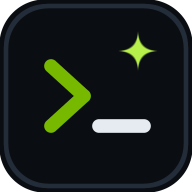

<p align="center">
  
</p>

<h1 align="center">nullx11<code>code</code></h1>

<p align="center">
  <b>Free-first AI coding agent</b> for your terminal <b>and</b> your browser.<br/>
  Many providers · NVIDIA NIM flagship · model icons · project skills · <code>/</code>slash commands
</p>

<p align="center">
  
  <a href="#setup">Setup</a> ·
  <a href="#cli-commands">CLI commands</a> ·
  <a href="#slash-commands">Slash commands</a> ·
  <a href="#web-ui">Web UI</a> ·
  <a href="#skills">Skills</a> ·
  <a href="#providers">Providers</a> ·
  <a href="docs/BRAINSTORM.md">Roadmap</a>
</p>

---

## Why?

- **Zero dependencies** — one Node script, no `node_modules` graveyard, runs on anything with Node ≥ 18 (including Termux on Android).
- **Free-first providers** — NVIDIA NIM, Groq, Cerebras, OpenRouter `:free`, Gemini, Mistral, GitHub Models, local Ollama/LM Studio. Keys auto-detected from env / `.env` / config; free ones are preferred automatically.
- **Model auto-detect + icons** — fetches `/models`, picks the best free model, and shows every model with its family icon (Llama 🦙, Qwen, DeepSeek, Nemotron… — SVG in the web UI, colored monogram chips in the terminal).
- **Skills are folders** — point a project at *any* folder of `SKILL.md`s; toggle them per project; active ones inject into the system prompt.
- **`/`slash commands** — `/model`, `/skills`, `/provider`, `/serve`, `/doctor`… with tab completion, like opencode.
- **Agent tools with approval** — reads/greps/lists freely; every **write** and **shell** command waits for your `[y/n/a]`.
- **Terminal + Web in one** — `nullx11code serve` launches the same agent as a mobile-friendly web app.

## Setup

Everything needed to get installed and chatting — in order.

### 1. Install

```sh
curl -fsSL https://raw.githubusercontent.com/Inkflow-Gab/nullx11code/main/install.sh | sh
```

or with npm directly:

```sh
npm i -g https://codeload.github.com/Inkflow-Gab/nullx11code/tar.gz/refs/heads/main
```

<details>
<summary>Mobile / Termux (Android)</summary>

```sh
pkg install nodejs-lts
curl -fsSL https://raw.githubusercontent.com/Inkflow-Gab/nullx11code/main/install.sh | sh
```

The CLI is line-based ANSI with auto-width, no mouse, and no bracketed-paste tricks — it behaves in small phone terminals. Non-TTY (piped) input works too: `echo "hello" | nullx11code`.
</details>

### 2. Add a free API key

Put **one** free key in `.env` (project) or `~/.nullx11code/.env` (global):

```sh
echo "NVIDIA_API_KEY=nvapi-…" >> .env        # build.nvidia.com
echo "GROQ_API_KEY=gsk_…" >> .env            # console.groq.com
# more free keys: .env.example
```

### 3. Verify

```sh
nullx11code doctor        # checks keys, network, skills, node version
```

### 4. Chat

```sh
nullx11code                          # interactive
nullx11code "explain this repo"      # one-shot
nullx11code serve                    # web UI instead
```

```
  ▗▄▖▐▌ ▐▌ nullx11code v0.1.0
  free-first AI coding agent · terminal + web
  2 keys · 4 skills · /help for commands
  model ▌NVIDIA NIM · nvidia/llama-3.3-70b-instruct · LL Llama

❯ /help
```

## CLI commands

Top-level `nullx11code <command>` (run in your shell, before the chat starts):

| Command | Description |
|---|---|
| `nullx11code` | start interactive chat |
| `nullx11code "prompt"` / `-p "prompt"` | one-shot answer, then exit |
| `serve [port]` | launch the web UI (default `7860`, `0.0.0.0` for LAN/mobile) |
| `providers` | list all providers + which keys are detected |
| `models` | list models for a provider (`--provider <id>`) |
| `skills` | show discovered skills and their status |
| `doctor` | diagnose keys / network / skills / node |
| `config` | print config paths + merged config |
| `icon [app\|cli\|provider]` | print built-in icons |
| `update` | print the update command |
| `banner` | print the startup banner |
| `version` \| `-v` | version info |
| `help` \| `-h` | help |

**Flags:** `--provider <id>` · `--model <id|auto>` · `--no-color` · `-y / --yes` (auto-approve tools) · `--resume [id]` · `-p "prompt"`

<details>
<summary>Update / uninstall</summary>

```sh
# update (re-run installer or)
npm i -g https://codeload.github.com/Inkflow-Gab/nullx11code/tar.gz/refs/heads/main

# uninstall
npm rm -g nullx11code
```
</details>

## Slash commands

Typed **inside the chat** (Tab-completes, prefix works: `/ex` → `/extra`):

| Command | Description |
|---|---|
| `/help [cmd]` | help (incl. your custom `.nullx11` commands) |
| `/model [id\|#]` | switch model (shows family icons) |
| `/models` | list models of current provider |
| `/provider [id]` | switch provider |
| `/providers` | all providers + key status |
| `/skills`, `/skill on\|off <n>` | manage skills |
| `/new`, `/clear` | fresh chat / clear screen |
| `/history`, `/load <id>` | saved sessions |
| `/export [file]` | export chat as markdown |
| `/usage` | token estimate |
| `/config [k=v]` | view/set config |
| `/settings` | toggles (stream, approvals, colors) |
| `/serve [port]` | launch web UI |
| `/doctor` | diagnose keys/network/skills |
| `/icon [app\|cli\|provider\|model]` | print icons |
| `/compact` | shrink history |
| `/quit` | exit |

## Web UI

```sh
nullx11code serve          # http://localhost:7860
nullx11code serve 3000     # custom port
```

- **Landing page** with the app/CLI icons, an animated *download-the-CLI* terminal (typing + progress bar), and the provider strip.
- **Chat view** with provider/model pickers (icons!), skills toggles, session history, streaming markdown, and approval modals for tool actions.
- Serves on `0.0.0.0` so your phone on the same network can open the LAN URL shown at startup.

## Skills

A skill is a folder with a `SKILL.md`:

```
.nullx11code/skills/
  code-review/SKILL.md
  commit-msg/SKILL.md
my-skills-folder/          ← any folder you point at
  sql-helper/SKILL.md
```

```markdown
---
name: code-review
description: Reviews changed code for bugs and security issues
always: false
---
# Code Review
…instructions the model follows when the skill is active…
```

| Command | Effect |
|---|---|
| `/skills` | list skills with status |
| `/skills add <dir>` | **use a whole folder of skills in this project** |
| `/skills new <name>` | scaffold a new skill |
| `/skills on\|off <name>` | toggle (persists in `.nullx11code/config.json`) |

Discovery order: config `skills.dirs` → project `.nullx11code/skills` → project `skills/` → global `~/.nullx11code/skills`.
When a message looks like it matches an inactive skill, the CLI hints: `💡 skill "code-review" may apply`.

Four ready-made skills ship in [`examples/skills/`](examples/skills): `code-review`, `commit-msg`, `sql-helper`, `explain-repo`.

## Custom commands — `.nullx11/*.md`

Drop any markdown file into **`.nullx11/`** (auto-detected in the project where you run the CLI — or in `~/.nullx11/` for global ones) and it becomes a slash command named after the file:

```
.nullx11/
  extra.md          →  /extra
  commands/pixel.md →  /pixel      (subfolder works too)
```

```markdown
---
description: Create a polished animation for this project
example: /extra make the hero icon float with binary rain
---
Do the following for: $ARGUMENTS
…instructions…
```

- **Prefix peek**: typing `/ex` shows `→ /extra  Create a polished animation… (from /ex)` and runs it — even though the builtin `/exit` also starts with `ex` (unique custom match wins; if several match you get a candidate list).
- **`$ARGUMENTS`** is replaced by whatever you type after the command; if the body has no placeholder, your words are appended.
- The expanded prompt is sent to the model like a normal message (skills + tools still apply).
- `/help` lists them under **Custom commands** with description + example; Tab-completion includes them too.
- Extra folders can be added via config: `"commands": { "dirs": ["/path/to/cmds"] }`.

Two are bundled: `.nullx11/extra.md` (animation creator) and `.nullx11/commands/pixel.md` (anime-sprite artist).

## Providers

| Provider | Cost | Key env var | Notes |
|---|---|---|---|
| **NVIDIA NIM** | 🟢 free | `NVIDIA_API_KEY` | flagship — free credits, no card |
| **Groq** | 🟢 free | `GROQ_API_KEY` | free tier, very fast |
| **Cerebras** | 🟢 free | `CEREBRAS_API_KEY` | free developer tier |
| **OpenRouter** | 🟢 free | `OPENROUTER_API_KEY` | hundreds of models, `:free` ids |
| **Google Gemini** | 🟢 free | `GEMINI_API_KEY` | free Flash tier |
| **Mistral** | 🟢 free | `MISTRAL_API_KEY` | free credits |
| **GitHub Models** | 🟢 free | `GITHUB_TOKEN` | free with your GH token |
| **Ollama** | 🟢 free | — | local, offline |
| **LM Studio** | 🟢 free | — | local server |
| Together AI | 🔵 paid | `TOGETHER_API_KEY` | optional |
| OpenAI | 🔵 paid | `OPENAI_API_KEY` | optional |
| *custom* | — | config `providers.custom` | any OpenAI-compatible endpoint |

Keys are read from: process env → `~/.nullx11code/.env` → `./.env` → config. **Keys never leave your machine** — the web UI proxies through the local server only.

## Agent tools

| Tool | Approval |
|---|---|
| `list_files` | automatic |
| `read_file` | automatic |
| `grep` | automatic |
| `write_file` | **asks** (`y/n/a`) |
| `shell` | **asks** (`y/n/a`) |

`a` = always approve this kind for the session. Print mode auto-rejects mutations unless `-y`.

## Configuration

Project: `.nullx11code/config.json` · Global: `~/.nullx11code/config.json`

```json
{
  "provider": "nvidia",
  "model": "auto",
  "temperature": 0.7,
  "skills": { "dirs": ["/path/to/skills"], "enabled": ["code-review"] },
  "approvals": { "shell": true, "write": true },
  "port": 7860
}
```

## Development

```sh
npm test          # node --test suite (mock provider e2e included)
npm start         # run the CLI from source
npm run serve     # web UI from source
npm run icons     # regenerate provider/model SVG icons
npm run icons:png # regenerate PNG app icons
```

Architecture (zero deps, all first-party):

```
bin/nullx11code.js     entry
src/main.js            argv dispatch
src/cli.js             interactive REPL (streaming, approvals)
src/chat.js            SSE streaming + agent tool loop
src/providers.js       provider registry + /models + auto-pick
src/skills.js          skill discovery/frontmatter/injection
src/tools.js           list/read/write/grep/shell (+ approval)
src/commands.js        /slash commands
src/server.js          web server (static + JSON + SSE)
src/web/               landing + chat UI (vanilla JS)
src/ui.js              ANSI, badges, banner, markdown, spinner
assets/icons/          app, CLI, provider & model-family SVGs + PNGs
```

## License

MIT — see [docs/BRAINSTORM.md](docs/BRAINSTORM.md) for the roadmap and wild ideas.
